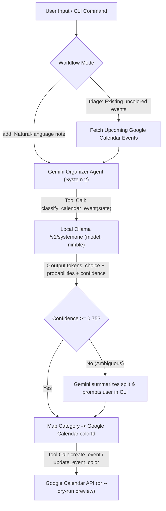

# :zap: Nimble + Gemini Calendar Organizer Agent

Hybrid **System 1 (`nimble` on local Ollama)** + **System 2 (Google Gemini)** agentic workflow for parsing, classifying, and color-coding Google Calendar entries across four life categories (`family`, `work`, `leisure`, `faith`).

---

## :brain: Architecture: System 1 + System 2 Separation of Duties

Standard LLM pipelines burn generative tokens just to classify a string into a fixed set of categories. This project splits the cognitive workload between two specialized engines:

1. **System 1 Classifier (`nimble` via local Ollama `/v1/systemone`)**:
   - Evaluates the calendar event text against your four fixed `criteria` keys in a single forward pass with **`0` output tokens**.
   - Returns a calibrated probability simplex (`sum(p) = 1.0`) and a `confidence` score without any possibility of schema hallucination.
2. **System 2 Organizer (Google Gemini via `google-genai`)**:
   - Parses unstructured natural-language notes (dates, start/end times, summaries, locations).
   - Calls the local `nimble` classifier as a tool to retrieve the category and Google Calendar `colorId`.
   - Reviews split probabilities when `confidence < 0.75` and prompts you interactively in the terminal.
   - Schedules or updates the color-coded event via the Google Calendar v3 API.



---

## :art: Category Criteria & Google Calendar Color Mapping

Criteria are loaded from [`faith-template.json`](./faith-template.json) and mapped deterministically to Google Calendar event `colorId` values:

| Category | Nimble Criteria | Google Calendar Color | `colorId` |
| --- | --- | --- | --- |
| `family` | `"Wife Jackie, kids, grandkids, in-laws"` | Peacock (Blue) | `"7"` |
| `work` | `"AI Development, Team Oversight"` | Graphite (Gray) | `"8"` |
| `leisure` | `"Live music, football game, relax with friends"` | Sage (Green) | `"2"` |
| `faith` | `"Church on Sundays, teaching Sunday school, church community group"` | Grape (Purple) | `"3"` |

---

## :rocket: Getting Started

### 1. Prerequisites

- **Python 3.10+**
- **Local Ollama** running with the `nimble` model serving `http://localhost:11434/v1/systemone`
- **Gemini API Key** (`GEMINI_API_KEY`)
- **Google Calendar OAuth 2.0 Desktop Client JSON** (`credentials.json`, optional when using `--dry-run`)

### 2. Installation

```bash
pip install -r requirements.txt
cp .env.example .env
```

Edit `.env` and set your `GEMINI_API_KEY` (and adjust `CONFIDENCE_THRESHOLD` or `GOOGLE_CALENDAR_ID` if needed).

---

## :terminal: CLI Usage

### 1. Direct System 1 Classification (`classify`)

Test the local Ollama `nimble` classifier, probability simplex, and color mapping on any event string:

```bash
python -m calendar_agent classify "Preparing my Sunday school lesson and meeting with our church community group."
```

### 2. Add a New Event from Natural Language (`add`)

Have Gemini parse your written note, invoke local `nimble` to assign the category color, and create the Google Calendar event (pass `--dry-run` to preview the wire payload without touching Google Calendar):

```bash
python -m calendar_agent add "Dinner with Jackie and the grandkids this Friday from 6pm to 8pm" --dry-run
```

### 3. Triage Existing Uncolored Calendar Events (`triage`)

Scan upcoming uncolored Google Calendar events, classify each with `nimble` (triggering Gemini review if `confidence < 0.75`), and patch their `colorId`:

```bash
python -m calendar_agent triage --days 14 --dry-run
```

---

## :white_check_mark: Running Tests

```bash
python -m unittest discover -s tests -v
```

---

## :link: Related Repository

- Companion PowerShell System 1 POC: [m2web/ollama-local-sysytem-one-llm](https://github.com/m2web/ollama-local-sysytem-one-llm)
