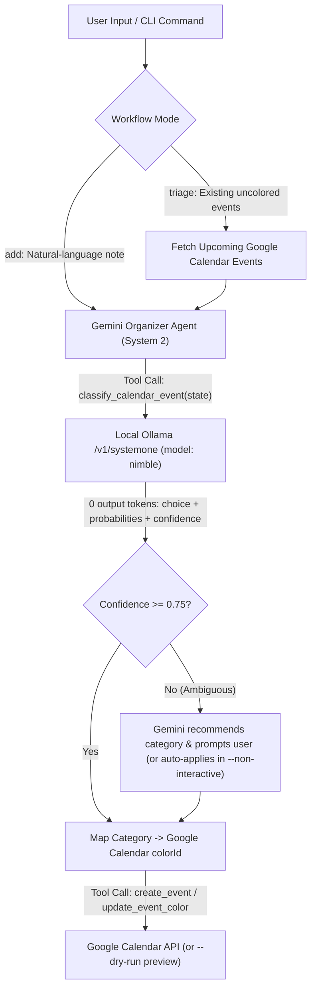

# :zap: Nimble + Gemini Calendar Organizer Agent

Hybrid **System 1 (`nimble` on local Ollama)** + **System 2 (Google Gemini)** agentic workflow for parsing, classifying, and color-coding Google Calendar entries across four life categories (`family`, `work`, `leisure`, `faith`).

---

## :brain: Architecture: System 1 + System 2 Separation of Duties

Standard LLM pipelines burn generative tokens just to classify a string into a fixed set of categories. This project splits the cognitive workload between two specialized engines:

1. **System 1 Classifier (`nimble` via local Ollama `/v1/systemone`)**:
   - Evaluates the calendar event text against your four fixed `criteria` keys in a single forward pass with **`0` output tokens**.
   - Returns a calibrated probability simplex (`sum(p) = 1.0`) and a `confidence` score without any possibility of schema hallucination.
2. **System 2 Organizer (Google Gemini via `google-genai`)**:
   - Parses unstructured natural-language notes (dates, start/end times, summaries, locations).
   - Calls the local `nimble` classifier as a tool to retrieve the category and Google Calendar `colorId`.
   - Reviews split probabilities when `confidence < 0.75`, provides a `Recommended: <category>` judgment, and either prompts you interactively in the terminal or applies its recommendation automatically in `--non-interactive` mode.
   - Schedules or updates the color-coded event via the Google Calendar v3 API (with automatic socket retry handling).



---

## :art: Category Criteria & Google Calendar Color Mapping

Criteria are loaded from [`calendar_agent/config.py`](./calendar_agent/config.py) (or [`example-template.json`](./example-template.json)) and mapped deterministically to Google Calendar event `colorId` values:

| Category | Nimble Criteria | Google Calendar Color | `colorId` |
| --- | --- | --- | --- |
| `family` | `"Wife Jackie, kids, grandkids, in-laws"` | Peacock (Blue) | `"7"` |
| `work` | `"AI Development, Team Oversight"` | Graphite (Gray) | `"8"` |
| `leisure` | `"Live music, football game, relax with friends"` | Sage (Green) | `"2"` |
| `faith` | `"Church on Sundays, teaching Sunday school, church community group, prayer"` | Grape (Purple) | `"3"` |

### Keeping Personal Criteria Private (`--skip-worktree`)

To customize `DEFAULT_CRITERIA` in [`calendar_agent/config.py`](./calendar_agent/config.py) with personal family names, locations, or project keywords without ever committing them to Git, lock the file locally before editing:

```bash
git update-index --skip-worktree calendar_agent/config.py
```

### Example System 1 Wire Files

The repository root includes three reference JSON files illustrating the local Ollama `/v1/systemone` wire contract:

- [`example-template.json`](./example-template.json) - Input template with empty `state` and the four category `criteria` definitions.
- [`example-payload.json`](./example-payload.json) - Populated request payload sent to `POST http://localhost:11434/v1/systemone`.
- [`example-response.json`](./example-response.json) - Zero-output-token response containing `choice`, `confidence`, `probabilities`, and `usage`.

---

## :rocket: Getting Started

### 1. Prerequisites

- **Python 3.10+**
- **Local Ollama** running with the `nimble` model serving `http://localhost:11434/v1/systemone`
- **Gemini API Key** (`GEMINI_API_KEY` from [Google AI Studio](https://aistudio.google.com/apikey), using `gemini-3.8-flash` by default)
- **Google Calendar OAuth 2.0 Desktop Client JSON** (`credentials.json`, optional when using `--dry-run`)

### 2. Installation

```bash
pip install -r requirements.txt
cp .env.example .env
```

Edit `.env` and set your `GEMINI_API_KEY` (and adjust `GEMINI_MODEL`, `CONFIDENCE_THRESHOLD`, or `GOOGLE_CALENDAR_ID` if needed).

### 3. Google Calendar OAuth 2.0 Setup (For Live Calendar Read/Write)

1. In [Google Cloud Console](https://console.cloud.google.com/apis/library/calendar-json.googleapis.com), enable the **Google Calendar API**.
2. Go to **Google Auth Platform -> Audience** (`https://console.cloud.google.com/auth/audience`) and under **Test users**, click **+ Add users** to add your own Google Calendar email address (required while the app is in `Testing` status to avoid `Error 403: access_denied`).
3. Go to **APIs & Services -> Credentials**, click **+ Create Credentials -> OAuth client ID**, select **Desktop app**, and download the JSON file as `credentials.json` in the repository root.
4. On your first live `add` or `triage` run (without `--dry-run`), a browser window will open for a one-time OAuth approval and cache `token.json` locally.

---

## :terminal: CLI Usage

All subcommands support `--no-audit` (skip writing `response-<choice>-<timestamp>.json` files) and `--non-interactive` (auto-apply Gemini's `Recommended: <category>` when `confidence < 0.75`, or System 1's top choice in standalone `classify`, without waiting for terminal input).

### 1. Direct System 1 Classification (`classify`)

Test the local Ollama `nimble` classifier, probability simplex, and color mapping on any event string:

```bash
python -m calendar_agent classify "Preparing my Sunday school lesson and meeting with our church community group."
```

### 2. Add a New Event from Natural Language (`add`)

Have Gemini parse your written note, invoke local `nimble` to assign the category color, and create the Google Calendar event (pass `--dry-run` to preview the wire payload without touching Google Calendar):

```bash
python -m calendar_agent add "Dinner with Jackie and the grandkids this Friday from 6pm to 8pm" --dry-run
```

### 3. Triage Existing Uncolored Calendar Events (`triage`)

Scan upcoming uncolored Google Calendar events from `now` forward, classify each with `nimble` (triggering Gemini review if `confidence < 0.75`), and patch their `colorId`:

```bash
python -m calendar_agent triage --days 14 --dry-run
```

> **Note on Shared Calendars:** By default, `triage` operates on `GOOGLE_CALENDAR_ID=primary`. Events displayed from secondary or shared calendars require `"Make changes to events"` (`writer`) access on that specific calendar ID in order to set per-event `colorId` values via the API.

---

## :white_check_mark: Running Tests

```bash
python -m unittest discover -s tests -v
```

---

## :link: Related Repository

- Companion PowerShell System 1 POC: [m2web/ollama-local-sysytem-one-llm](https://github.com/m2web/ollama-local-sysytem-one-llm)
